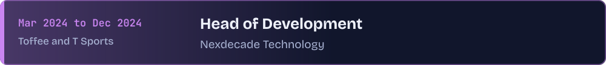
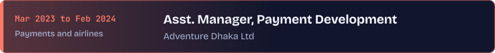

I design and run backend systems for businesses that depend on them every day: enterprise ERP in Singapore, payments across Asia, healthcare distribution in Bangladesh, and streaming on Toffee, one of Bangladesh's biggest OTT platforms with 50M+ Google Play downloads, and T Sports. I've led a team of 53 developers, and I still write the code. I've also built face recognition attendance, PCB mismatch detection and a TZone temperature gateway system, and I work with high-scale MongoDB clusters, Kubernetes and Active Directory.

I'm a Software Engineer IV at Techzu Ichicode, a Singapore company, working hybrid from its Dhaka office.

- Architected the ERP for Singapore's largest aircon distributor, serving 10,000+ B2B clients
- Built a WhatsApp Business integration that automates customer inquiries
- Developed an AI document platform with OCR search that automates document processing
- Integrated payments across 5 enterprise applications, including HitPay and AXS, with SGD 500K+ a month at 99.99% uptime
- Built construction management software tracking 200+ active sites
- Mentor a team of 8 engineers, with a 95% sprint completion rate

- Led 53 developers across several stacks and delivered 25% faster after moving the teams to agile
- Led development on Toffee, one of Bangladesh's biggest OTT platforms with 50M+ Google Play downloads, and T Sports with 5M+, serving millions of users with Spring Boot, Docker and Kubernetes
- Oversaw WebRTC video calling, plus VMS and HRM products
- Improved system performance by 30% and cut infrastructure costs by 20%
- Brought API gateway response times under 200 ms

- Built a global payment platform processing 1M+ transactions a day at a 99.8% success rate, using Spring Boot, Docker, Kubernetes and Kafka
- Integrated gateways including PayPal, Adyen, Toss Pay, KakaoPay and 2C2P across the Philippines, Korea, Japan and India
- Led NDC airline integration, including Lufthansa, and a multi-currency global hotel booking platform
- Migrated the monolith to microservices

- Built ordering systems for 10,000+ pharmacy clients and 800+ mobile field users
- Automated ERP processes across 20+ branches, including HRM from recruitment to payroll
- Delivered patient and inventory management with FEFO stock logic, handling 5,000+ invoices a day
- Built real-time IoT temperature monitoring with C# and Socket.io
- Worked on Active Directory for central user accounts and access management

- **Sr. Software Engineer, Advance Business Solutions:** business and education ERP for 50+ clients, with a 20% performance gain
- **Software Engineer, IECL:** government systems serving 10M+ users and banking systems handling 10K+ requests a day

**Languages**

     

**Backend**

    

**Data**

     

**Real time and infrastructure**

       

**Frontend and mobile**

    

**AI**

       

BSc, Asian University of Bangladesh, GPA 3.90

Training: AWS Solutions Architect Associate, ISMS Internal Auditor

I'm glad to talk about backend architecture, payments, ERP and leading engineering teams.

